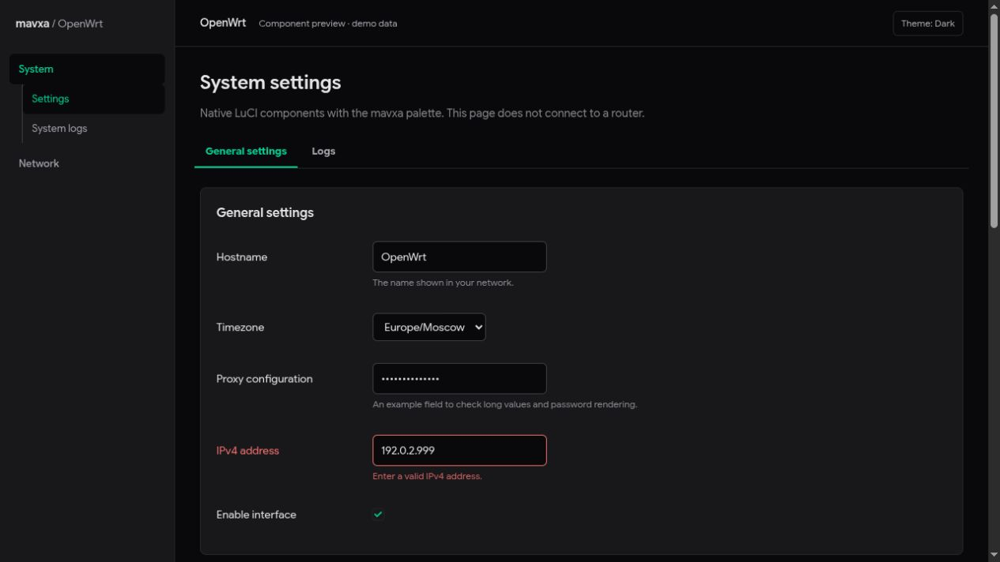

# luci-theme-mavxa

A minimal LuCI theme with graphite surfaces, a mint accent, light and dark modes, and readable forms and logs.

The first implementation provides a native LuCI shell, responsive navigation, dark/light/auto modes, forms, tables, dialogs, and log styling. It is based on OpenWrt's maintained 2020 theme layout. Nothing has been installed on a router.

It targets OpenWrt 25.12 with ucode templates. Other LuCI versions have not been tested.



## Design

[Interactive prototype](https://p.superdesign.dev/draft/49d994d1-e518-46a2-922a-baf7dc203fa4) · [Superdesign canvas](https://superdesign.dev/teams/7468afe0-be48-46ce-94a1-4d0a32739a85/projects/b1e373c4-d977-43a8-8a80-e9708ca54228)

The prototype uses demo records and simulated connections. It describes the intended interface; it does not provide a router backend.

## Layout

```text
htdocs/luci-static/       Browser CSS and JavaScript
ucode/template/themes/   LuCI templates
root/etc/uci-defaults/   Theme registration
docs/                    Design decisions and implementation notes
tests/                   Targeted checks
dev/                     Offline component preview
Makefile                 OpenWrt package metadata
```

## Scope

Target OpenWrt 25.12 and its ucode-based LuCI templates first. Keep native navigation, forms, validation, permissions, and save/apply behavior. All new interface copy is English. A theme does not change the language of installed LuCI applications.

Subscription import and changes to Podkop routing belong in separate work. Log search and filtering from the prototype need a real LuCI view; CSS alone cannot implement them.

## Local preview and checks

No frontend build or npm dependencies are needed. Serve the repository root:

```sh
python -m http.server 8768 --bind 127.0.0.1
```

Open [the component preview](http://127.0.0.1:8768/dev/preview.html). It contains example LuCI markup and demo data, without a router connection. It does not exercise the LuCI menu RPC or real save/apply operations.

```sh
node --test tests/theme.test.mjs
node --check htdocs/luci-static/mavxa/theme.js
node --check htdocs/luci-static/resources/menu-mavxa.js
sh -n root/etc/uci-defaults/30_luci-theme-mavxa
```

## Build and enable

Use an [OpenWrt SDK](https://openwrt.org/docs/guide-developer/toolchain/using_the_sdk) or buildroot for the target release. This repository must be placed under `package/luci-theme-mavxa`, with the LuCI feed installed at `feeds/luci`.

Select `luci-theme-mavxa` as a module in `make menuconfig`, then build:

```sh
make package/luci-theme-mavxa/compile V=s
```

After installing the built package, choose **Mavxa** in **System → System → Language and Style**. Select English there if needed. Registration adds the theme as an option and preserves the currently selected theme, language, and network settings.

Keep another installed theme available. Switch back to it before removing this package. Dark/light/auto preference is stored in this browser, not in router configuration.

## Validation status

Theme behavior tests and JavaScript/shell syntax checks pass. Both ucode templates compile with the OpenWrt 25.12.2 ucode compiler. Desktop dark/light rendering, mobile navigation, example forms, and a dialog have been checked in the offline preview.

An SDK package build, live installation, and compatibility with actual Podkop pages are still pending. The theme does not implement the prototype's log filters, export, or connection dashboard yet.

## Contributing

Use focused conventional commits, such as `feat:`, `fix:`, `docs:`, and `chore:`. Do not commit router backups, credentials, subscription links, or live configuration.

## License

Apache-2.0. See [LICENSE](LICENSE) and [NOTICE](NOTICE) for upstream attribution.
